  

  <strong>Desenvolvedor back-end pleno</strong> · mais de 5 anos construindo sistemas em produção

  <a href="https://github.com/LuisInacioDasilva?tab=repositories">Repositórios</a> ·
  <a href="https://github.com/Innovation-Brindes">Innovation Brindes</a>

## Engenharia que sustenta a operação

Trabalho há mais de cinco anos com o ciclo completo de sistemas back-end: desenho de soluções, implementação, integração, banco de dados, diagnóstico de falhas e evolução de código que já está em produção. Meu foco é fazer regras de negócio complexas funcionarem de forma confiável no dia a dia.

Meu repertório passa por **C, C#, PHP, Java, JavaScript/TypeScript, Node.js e Python**, com SQL como parte central do trabalho. Também há projetos em Kotlin, SQLite e outras tecnologias no histórico do GitHub. Já passei por fluxos de **CRM, ERP, vendas, pedidos, atendimento e automação**. Gosto especialmente dos pontos em que aplicação, dados e integrações precisam concordar entre si.

<table>
  <tr>
    <td width="50%" valign="top">
      <strong>01 / BACK-END</strong>  
      APIs, regras de negócio, autenticação, serviços, processamento assíncrono e manutenção de sistemas legados.
    </td>
    <td width="50%" valign="top">
      <strong>02 / DADOS</strong>  
      SQL Server e PostgreSQL, consultas, modelagem, conciliação, integridade e rastreabilidade de alterações.
    </td>
  </tr>
  <tr>
    <td width="50%" valign="top">
      <strong>03 / INTEGRAÇÕES</strong>  
      ERP, APIs externas, webhooks, mensageria e fluxos que precisam continuar íntegros mesmo quando uma etapa falha.
    </td>
    <td width="50%" valign="top">
      <strong>04 / AUTOMAÇÃO</strong>  
      n8n, rotinas operacionais, análise de dados e LLMs integrados a processos reais, com validação, tratamento de erro e acompanhamento.
    </td>
  </tr>
</table>

## Tecnologias no meu repertório

  

  <code>SQL Server</code> · <code>PostgreSQL</code> · <code>APIs</code> · <code>Laravel</code> · <code>n8n</code> · <code>LLMs</code>

## IA aplicada e orquestração

Uso **LLMs, ferramentas de IA e n8n** para conectar informações, automatizar etapas e apoiar decisões dentro de sistemas existentes. O trabalho inclui classificação, tradução, extração de dados, integração com APIs e fluxos com acompanhamento humano quando necessário. A parte importante é o resultado chegar corretamente à operação e poder ser auditado.

Como este perfil é mantido

O texto e o banner SVG ficam neste repositório. Para conferir o robô localmente, execute `node scripts/preview-contribution-bot.mjs`; o arquivo gerado fica em `dist/contribution-bot.svg`. O gerador de produção usa `GITHUB_TOKEN` e `GITHUB_USER` como variáveis de ambiente. Mudanças entram por branch e pull request; após o merge na `main`, o GitHub Actions atualiza o SVG no branch `output`. Para reverter, restaure o commit anterior por pull request e execute novamente o workflow.

## Contribuições em movimento

O robô abaixo percorre uma visualização do meu calendário real de contribuições. Os dados são atualizados automaticamente pelo GitHub Actions.

  

