  

  <strong>Desenvolvedor back-end pleno</strong> · mais de 5 anos construindo sistemas em produção

  <a href="https://github.com/LuisInacioDasilva?tab=repositories">Ver meus repositórios</a>

## Engenharia que sustenta a operação

Há mais de cinco anos, desenvolvo e sustento sistemas que fazem a operação acontecer. Atuo do desenho da solução à investigação de incidentes: **back-end, bancos de dados, integrações, cloud, automação e IA aplicada**, sempre com foco em confiabilidade e resultado em produção.

Na **Innovation Brindes**, construí integrações e evoluí fluxos de **CRM, ERP, vendas, pedidos, layouts e atendimento**. Trabalho com diferentes linguagens e plataformas conforme o problema; o ponto comum é conectar regras, dados e serviços sem perder a rastreabilidade da operação.

<table>
  <tr>
    <td width="50%" valign="top">
      <strong>01 / BACK-END</strong>  
      Evolução das APIs e dos fluxos de orçamento, pedido, layout e atendimento da Innovation Brindes. Regras de negócio, autenticação, jobs e manutenção de sistemas usados diariamente em produção.
    </td>
    <td width="50%" valign="top">
      <strong>02 / DADOS</strong>  
      MariaDB, SQL Server e PostgreSQL: consultas, modelagem e conciliação entre CRM, ERPs e outros sistemas. Investigação de divergências, integridade dos dados e histórico auditável das mudanças.
    </td>
  </tr>
  <tr>
    <td width="50%" valign="top">
      <strong>03 / INTEGRAÇÕES</strong>  
      Integrações da Innovation com ERPs, WhatsApp, Google Drive e AWS S3. APIs, webhooks, documentos e mídia em buckets, com tratamento de falhas e reprocessamento.
    </td>
    <td width="50%" valign="top">
      <strong>04 / AUTOMAÇÃO</strong>  
      Automações de atendimento e operação com n8n, filas e LLMs: tradução, classificação, extração de dados e relatórios, com validação, métricas e revisão humana quando necessário.
    </td>
  </tr>
</table>

## Tecnologias no meu repertório

  

  <code>SQL Server</code> · <code>PostgreSQL</code> · <code>MariaDB</code> · <code>AWS S3</code> · <code>Google Drive</code> · <code>APIs</code> · <code>n8n</code> · <code>LLMs</code>

## IA aplicada e orquestração

Integro **LLMs e ferramentas de IA** a sistemas reais para reduzir trabalho repetitivo e acelerar decisões: leitura de mensagens e documentos, classificação, tradução, extração de informações e apoio ao time comercial. Desenho esses fluxos com contexto de negócio, validação e rastreabilidade — não como uma vitrine isolada da operação.

## Contribuições em movimento

  

