<p align="center">
  
</p>

<p align="center">
  <a href="https://github.com/LuisInacioDasilva?tab=repositories"></a>
  
  
</p>

## Backend é onde eu trabalho melhor.

Meu território é o pedaço que ninguém vê quando tudo funciona: **regra de negócio, integração, fila, banco, retry, log e recuperação de falha**.

Hoje eu construo e mantenho sistemas de produção com **Laravel/PHP**, conecto ERP, atendimento e serviços externos, e uso **LLMs** quando eles resolvem operação de verdade — não para colocar “IA” no nome do projeto.

```text
HTTP → Laravel → Service Layer → Queue / Job → Integrações
                    │                │
                    ├── SQL          ├── Webhooks
                    ├── Auditoria    └── LLM tools
                    └── Logs + retry + idempotência
```

## Laravel / PHP, sem firula.

<table>
  <tr>
    <td width="50%" valign="top">
      <strong>01 — CORE BACKEND</strong><br><br>
      APIs REST, autenticação, validação, services, jobs, queues, schedulers e regras que precisam continuar corretas depois do deploy.
    </td>
    <td width="50%" valign="top">
      <strong>02 — INTEGRAÇÕES</strong><br><br>
      ERP, webhooks, mensageria, provedores externos, conciliação e fluxos com rastreabilidade de ponta a ponta.
    </td>
  </tr>
  <tr>
    <td width="50%" valign="top">
      <strong>03 — DADOS</strong><br><br>
      SQL Server, PostgreSQL, modelagem, consultas, consistência, auditoria e correção segura de dados legados.
    </td>
    <td width="50%" valign="top">
      <strong>04 — LLM AUTOMATION</strong><br><br>
      Saída estruturada, tools, contexto, classificação e automações com fallback, custo controlado e comportamento observável.
    </td>
  </tr>
</table>

## Ferramentas que entram no meu deploy.

<p align="center">
  
</p>

<p align="center">
  
  
  
  
</p>

## Regras do meu código.

```php
final class ProductionMindset
{
    public const RULES = [
        'idempotency > hope',
        'logs are part of the product',
        'legacy code has context',
        'boring deploys are good deploys',
    ];
}
```

## Contributions, agora em movimento.

<picture>
  <source media="(prefers-color-scheme: dark)" srcset="https://raw.githubusercontent.com/LuisInacioDasilva/LuisInacioDasilva/output/github-contribution-grid-snake-dark.svg" />
  <source media="(prefers-color-scheme: light)" srcset="https://raw.githubusercontent.com/LuisInacioDasilva/LuisInacioDasilva/output/github-contribution-grid-snake.svg" />
  
</picture>

<p align="center">
  <code>build → observe → fix → repeat</code>
</p>

